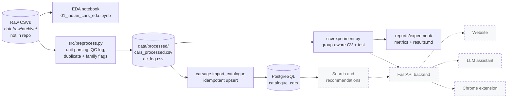

# CarSage AI

> Honest data, transparent models, and a clean foundation for an explainable Indian new-car marketplace.


CarSage AI is a course project (Artificial Intelligence) that aims to become an AI-assisted marketplace for **new cars in India**. This repository currently contains the **data and machine-learning foundation plus a PostgreSQL car catalogue**. The website, backend API, recommendation engine, LLM assistant and Chrome extension are **planned and not built yet**.

---

## Contents
[Overview](#overview) · [Status](#project-status) · [Architecture](#architecture) · [Data pipeline](#data-pipeline) · [Machine learning](#machine-learning-approach) · [Results](#evaluation-results) · [Database](#postgresql-catalogue) · [Structure](#repository-structure) · [Getting started](#getting-started) · [Roadmap](#roadmap) · [License](#license)

## Overview

Car buyers compare hundreds of variants across dozens of specification columns, with inconsistent units and missing values. Before any recommendation or assistant can be trustworthy, the underlying data has to be understood, cleaned traceably and evaluated honestly. This repository does that groundwork:

- an audited Indian new-car dataset (1,276 variants, 263 models, 39 makes) with documented quality problems
- a reproducible preprocessing pipeline where **every changed or blanked value is logged** and nothing is silently deleted or imputed
- a leakage-safe price-estimation experiment, evaluated with group-aware validation
- a PostgreSQL catalogue (`catalogue_cars`) loaded idempotently from the processed data

The price model estimates **new-car ex-showroom price only**. It is not a used-car resale predictor, and the dataset has no listings, sellers or dates (see [Limitations](#limitations)).

## Project status

| Area | Status | Evidence |
|---|---|---|
| Exploratory data analysis | Done | [notebook](notebooks/01_indian_cars_eda.ipynb), [EDA summary](reports/eda_summary.md), 43 charts in [reports/figures/](reports/figures/) |
| Data audit and modelling-readiness review | Done | [data audit](reports/data_audit.md), [readiness review](reports/modelling_readiness.md) |
| Preprocessing pipeline with QC log | Done | [src/preprocess.py](src/preprocess.py) |
| Leakage-safe splits | Done | [src/modeling_setup.py](src/modeling_setup.py) |
| Price-model experiment (Dummy / Ridge / HistGradientBoosting) | Done, evaluated | [src/experiment.py](src/experiment.py), [results](reports/experiment/results.md) |
| PostgreSQL `catalogue_cars` + Alembic migration + idempotent import | Done | [carsage/](carsage/), [alembic/](alembic/) |
| Automated tests | 43 passing | [tests/](tests/) |
| Saved/served price model | Not started | the experiment does not persist a model |
| Search, constraint filtering, explainable recommendations | Planned | |
| FastAPI backend, authentication, user listings | Planned | `fastapi` is listed in `requirements-app.txt` but no routes exist |
| LLM assistant | Planned | no LLM SDK is installed or configured |
| Website | Planned | |
| Chrome extension | Planned | |

## Architecture

Solid boxes exist today; dashed boxes are planned.



## Data pipeline

**Dataset.** Two files, `cars_ds_final.csv` (1,276 rows) and `cars_ds_final_2021.csv` (1,267 rows), 141 columns each, one row per new-car *variant*. Comparison on the data showed the newer file is an updated, more complete version (17 more distinct variants, identical prices on shared variants), so it is the one analysed. The files are **not included** in this repository (see [Data and licensing](#data-and-licensing)).

**EDA** ([notebook](notebooks/01_indian_cars_eda.ipynb)). Missing values (43 columns are more than 50% empty), duplicates, distributions, outliers and correlations. Most columns are text with units (`Rs. 5,06,000`, `624 cc`), which the notebook parses on a copy.

**Audit findings** ([data audit](reports/data_audit.md)): price is complete and heavily right-skewed (log10 skew 1.24 vs raw 8.79); a few source data-entry errors (for example metres labelled `mm`, a `26032 km/litre` mileage); `Power` mixes PS/bhp/hp/kW; 9 exact duplicate rows; `Make` split at the wrong space in 41 rows.

**Preprocessing** ([src/preprocess.py](src/preprocess.py)). Reads the raw CSV (never modifies it) and writes `data/processed/cars_processed.csv` with the same 1,276 rows, 34 columns and a `source_row` id that traces back to the raw file. Rules, all logged to `qc_log.csv`:

| Rule | Behaviour |
|---|---|
| Unit parsing and conversion | numbers extracted from text; power converted to PS, torque to Nm |
| Implausible or wrong-unit values | set to `NaN` (never guessed or imputed), original text logged |
| `Make` recovery | filled only when the brand is stated in `Model`/`Variant` |
| Duplicates | flagged (`is_exact_duplicate`, `duplicate_of_source_row`), not removed |
| `family_group` | sibling models merged (for example Nexon / Nexon Ev) so splits cannot leak near-twins |

## Machine-learning approach

Goal: estimate **log1p(ex-showroom price)** from specifications, evaluated on the rupee scale.

- **Models:** `DummyRegressor` (median baseline), `Ridge`, `HistGradientBoostingRegressor`.
- **Feature configurations:** A uses 17 numeric and 7 categorical features; B adds the `Variant` text via TF-IDF (for the tree model, reduced with SVD).
- **Leakage control:** splits are by `family_group`, not by row; exact duplicates are never trained on or scored twice; identifiers (`source_row`, group columns, duplicate flags) can never be features. All imputers, encoders, scalers and TF-IDF are fitted on training folds only, inside sklearn pipelines, including the inner hyper-parameter search.
- **Evaluation:** 5-fold group-aware CV on development data (985 rows, 176 groups), then **one** evaluation on a held-out test set (291 rows, 45 groups, seed 42). Separately, a leave-one-make-out check on 10 makes.

## Evaluation results

All numbers are produced by `python src/experiment.py` and copied from [reports/experiment/](reports/experiment/results.md). Errors are in **lakh rupees** (1 lakh = ₹100,000), original price scale. Test intervals are 95% intervals from resampling whole family groups.

| Config | Model | CV MAE (±std) | Test MAE (95% interval) | Test median AE | Test MAPE |
|---|---|---|---|---|---|
| A (no Variant) | Dummy | 41.0 ± 13.3 | 33.2 (13.2–62.0) | 3.90 | 52.8% |
| A (no Variant) | Ridge | 15.3 ± 9.7 | 13.0 (5.4–24.9) | 1.20 | 19.7% |
| A (no Variant) | HistGB | 16.2 ± 10.6 | 13.2 (5.8–24.1) | 1.19 | 19.2% |
| B (+ Variant) | Ridge | 15.4 ± 8.6 | 13.0 (5.3–24.9) | 1.18 | 19.5% |
| B (+ Variant) | HistGB | 15.7 ± 9.8 | 13.9 (6.0–25.1) | 1.05 | 19.5% |

- Ridge and HistGradientBoosting both cut MAE by about 60% against the dummy baseline; **they are statistically indistinguishable** here, so no model is declared the winner.
- **Adding `Variant` shows no clear benefit:** the test MAE change has an interval that includes zero for both models.
- **Errors are concentrated in expensive cars.** Test MAE (Ridge, config A) by true price band: under ₹10 lakh 1.0; 10–30 lakh 2.8; 30 lakh–1 crore 18.1; over ₹1 crore 86.6 (31 test rows). In the 10–30 lakh band Ridge (2.8) is *worse* than the dummy (2.3).
- **Leave-one-make-out** (separate check, development data, 10 makes): pooled MAE 5.4 (Ridge A) vs 15.0 (dummy). Gains vary by make; for example Mahindra improves only about 28%.

### Limitations
- The evaluation is small: about 45 held-out groups, so intervals are wide and CV folds vary a lot.
- Even with `family_group`, a few under-merged model pairs remain (see [family-group audit](reports/experiment/family_group_audit.md)); scores are probably somewhat optimistic.
- New-car ex-showroom price at an unknown date only: not used-car resale, and no dates, sellers, locations or listing identifiers exist, so **fake-listing detection is not supported by this data**.

## PostgreSQL catalogue

[carsage/models.py](carsage/models.py) defines `catalogue_cars` (one row per car variant; `source_row` is the unique traceability key). Optional specifications are NULLable and stay NULL when the dataset has no value. The table deliberately has **no** seller, location, image or used-car price columns; user-created marketplace listings will be a separate table in a later phase. [alembic/versions/0001_create_catalogue_cars.py](alembic/versions/0001_create_catalogue_cars.py) creates it, and a test checks the migration against the models.

[carsage/import_catalogue.py](carsage/import_catalogue.py) loads `data/processed/cars_processed.csv` by upserting on `source_row`: invalid rows are rejected and reported, and re-running creates no duplicates. Verified locally: the first import inserted 1,276 rows, and repeat imports left them unchanged (1,276 rows, 1,276 distinct `source_row`).

## Repository structure

```text
.
├── carsage/                  PostgreSQL layer: db.py, models.py, import_catalogue.py
├── alembic/, alembic.ini     migrations (0001_create_catalogue_cars)
├── src/
│   ├── preprocess.py         raw CSV -> data/processed/ (+ QC log)
│   ├── modeling_setup.py     feature configs and leakage-safe splits
│   └── experiment.py         Dummy / Ridge / HistGB experiment and reports
├── notebooks/01_indian_cars_eda.ipynb   EDA (outputs cleared)
├── reports/                  eda_summary.md, data_audit.md, modelling_readiness.md, experiment/
├── tests/                    43 pytest tests
├── data/raw/, data/processed/            git-ignored data (placeholders only)
├── requirements-data.txt     data / ML dependencies
├── requirements-app.txt      application dependencies (partly unused so far)
└── .env.example              configuration placeholders
```

## Getting started

### Prerequisites
Python 3.12 (system Python 3.9 is end-of-life and not recommended), PostgreSQL 16, and the dataset files (not included).

### Install
```bash
python3.12 -m venv .venv && source .venv/bin/activate     # or: uv venv --python 3.12
pip install -r requirements.txt
```
`requirements-data.txt` is enough for the notebook, preprocessing and experiment. For only the database layer and tests you need `sqlalchemy`, `alembic`, `psycopg[binary]`, `python-dotenv`, `pandas<3`, `scikit-learn` and `pytest`. Note: pandas 3 is not supported by `src/preprocess.py`, hence the `<3` pin.

### Data
Place the dataset at `data/raw/archive/cars_ds_final.csv` (optionally `cars_ds_final_2021.csv` for the comparison in the notebook), then:
```bash
python src/preprocess.py        # writes data/processed/cars_processed.csv, qc_log.csv, transformations.json
```

### Configuration
```bash
cp .env.example .env            # .env is git-ignored: put real values only there
```
| Variable | Used today | Purpose |
|---|---|---|
| `DATABASE_URL` | yes | SQLAlchemy URL of the `carsage` database (`postgresql+psycopg://...`) |
| `TEST_DATABASE_URL` | yes | the `carsage_test` database for PostgreSQL tests (tests refuse any other database name) |
| `APP_ENV`, `SECRET_KEY`, `ACCESS_TOKEN_EXPIRE_MINUTES`, `CORS_ORIGINS` | not yet | reserved for the future backend |
| `LLM_PROVIDER`, `LLM_MODEL`, `ANTHROPIC_API_KEY`, `OPENAI_API_KEY` | not yet | reserved for the future assistant (provider not chosen) |

### Database
Run as a PostgreSQL superuser, choosing your own password (put it in `.env`):
```sql
CREATE ROLE carsage LOGIN PASSWORD '<your password>';
CREATE DATABASE carsage OWNER carsage;
CREATE DATABASE carsage_test OWNER carsage;
```
```bash
alembic upgrade head                   # creates catalogue_cars
python -m carsage.import_catalogue     # safe to re-run
```

### Run the components
```bash
jupyter lab notebooks/01_indian_cars_eda.ipynb   # EDA; do not commit executed outputs (they contain dataset rows)
python src/experiment.py                          # about 3 minutes; writes reports/experiment/
```

### Tests
```bash
python -m pytest tests
```
43 tests pass in the verified environment (Python 3.12, pandas 2.3.3, scikit-learn 1.6.1). Tests that need the processed data or the `carsage_test` database skip themselves when those are unavailable.

## Roadmap

All planned; none of it exists yet.

1. Save and load one evaluated price model with a model card and a prediction function.
2. Requirements-based search: hard constraint filtering plus heuristic ranking, with relaxation when nothing matches.
3. Knowledge-based rules that produce explainable recommendations.
4. FastAPI backend with basic authentication and a separate table for user-created listings.
5. LLM assistant that calls tools over the real catalogue and cannot name cars the tools did not return.
6. Website, then a Chrome extension for supported listing pages.
7. Responsible-AI notes: scope disclaimers (new-car estimates only), data limitations, and privacy.

## Contributing

This is a course project, but suggestions are welcome through issues and pull requests. Please keep the existing principles: never commit `.env`, credentials, raw or processed datasets, or executed notebook outputs; do not delete or silently alter data (log it); keep train/test splits group-aware; and run `python -m pytest tests` before submitting.

## Data and licensing

The dataset came from a Google share link supplied for the project. Its original source, licence and terms of use have **not been verified**, so the data files are git-ignored and are not distributed here. Publishing or redistributing the data is your responsibility to clear.

## License

**No license has been added to this repository yet.** Until one is added, no permission to reuse the code is granted, and this should not be treated as an open-source project.
