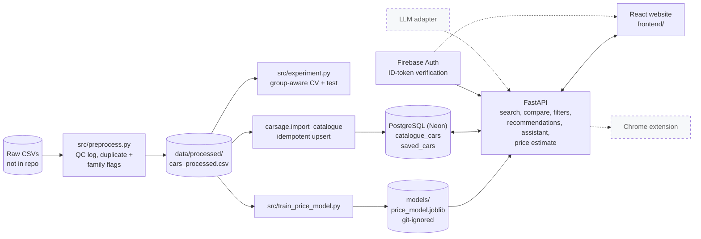

# CarSage AI

> Honest data, transparent models, and a clean foundation for an explainable Indian new-car marketplace.


CarSage AI is a course project (Artificial Intelligence) that aims to become an AI-assisted marketplace for **new cars in India**. This repository contains the **data and machine-learning foundation, a PostgreSQL car catalogue, and a FastAPI backend** (search, comparison, explainable recommendations, a catalogue-grounded rule-based assistant, an experimental price estimate, and Firebase-authenticated saved cars). A React 18 + TypeScript website with a premium light UI, a real Three.js showroom, verified model-family photography, exploration, details, comparison, an advisor, Firebase sign-in and saved cars sits on top of the API. The Chrome extension and any LLM integration are **planned, not built**.

---

## Contents
[Overview](#overview) · [Status](#project-status) · [Architecture](#architecture) · [API](#api) · [Authentication](#authentication-firebase) · [Data pipeline](#data-pipeline) · [Machine learning](#machine-learning-approach) · [Results](#evaluation-results) · [Database](#postgresql-catalogue) · [Structure](#repository-structure) · [Getting started](#getting-started) · [Tests](#tests) · [Roadmap](#roadmap) · [License](#license)

## Overview

Car buyers compare hundreds of variants across dozens of specification columns, with inconsistent units and missing values. Before any recommendation or assistant can be trustworthy, the underlying data has to be understood, cleaned traceably and evaluated honestly. This repository does that groundwork:

- an audited Indian new-car dataset (1,276 variants, 263 models, 39 makes) with documented quality problems
- a reproducible preprocessing pipeline where **every changed or blanked value is logged** and nothing is silently deleted or imputed
- a leakage-safe price-estimation experiment, evaluated with group-aware validation
- a PostgreSQL catalogue (`catalogue_cars`) loaded idempotently from the processed data

The price model estimates **new-car ex-showroom price only**. It is not a used-car resale predictor, and the dataset has no listings, sellers or dates (see [Limitations](#limitations)).

## Project status

| Area | Status | Evidence |
|---|---|---|
| Exploratory data analysis, data audit, preprocessing, leakage-safe price experiment | Done | [notebook](notebooks/01_indian_cars_eda.ipynb), [reports/](reports/), [src/](src/) |
| PostgreSQL catalogue (`catalogue_cars`) + Alembic migrations + idempotent import | Done, verified on local PostgreSQL 16 | [carsage/models.py](carsage/models.py), [alembic/](alembic/) |
| Neon-ready connection handling (SSL, pooled URL for the app, direct URL for migrations) | Implemented and unit-tested; **not yet verified against a live Neon database** | [carsage/db.py](carsage/db.py) |
| FastAPI: catalogue search, filters, detail, compare, health | Done | [carsage/app.py](carsage/app.py) |
| Explainable recommendation engine | Done | [carsage/recommend.py](carsage/recommend.py) |
| Catalogue-grounded assistant (rule-based, **no LLM**) | Done | [carsage/assistant.py](carsage/assistant.py) |
| Price estimate endpoint | Done, **experimental**; needs a local model file (`python src/train_price_model.py`) | [carsage/predict.py](carsage/predict.py) |
| Firebase token verification, saved cars (per-user) | Implemented; tested through the real Admin SDK code path with locally generated keys (valid, expired, wrong-project, forged, malformed tokens); **not yet tested against a real Firebase project** | [carsage/auth.py](carsage/auth.py) |
| Automated tests | passing (see [Tests](#tests)) | [tests/](tests/) |
| Website (React + TypeScript + Vite): landing, explore, car details, comparison, advisor, sign-in, saved cars | Cinematic light/dark UI, scroll motion and corrected model/category filters; 41 frontend tests, type checking and production build pass. Verified in Chrome at desktop/mobile sizes, including genuine WebGL rotation, photo/3D switching, fallback paths and catalogue workflows. Real Firebase sign-in remains unverified without credentials | [frontend/](frontend/) |
| LLM adapter, Chrome extension | Planned | |

## Architecture

Solid boxes exist today; dashed boxes are planned.



## API

Interactive docs: `http://127.0.0.1:8000/docs` once the server is running. Public endpoints need no login; `/api/me*` need a Firebase ID token (`Authorization: Bearer <token>`).

| Method and path | Purpose |
|---|---|
| `GET /api/health`, `GET /api/health/ready` | liveness (no database) and readiness (database check, 503 if down) |
| `GET /api/cars` | search (`q`, `make`, `model`, `fuel_type`, `transmission`, `body_type`, `min_price`, `max_price`, `min_seats`), `view=models\|variants`, `sort`, `page`, `page_size` (max 50) |
| `GET /api/cars/{id}` | full specifications, derived tags, related cars |
| `GET /api/cars/compare?ids=1,2,3` | 2-4 cars side by side, best value per row, missing-data markers |
| `GET /api/filters` | facets using the same search filters: makes, make-dependent models, fuel/body memberships, transmission groups, seats, price range |
| `POST /api/recommendations` | preferences in, ranked cars out with reasons, trade-offs, missing data and any relaxed constraints |
| `POST /api/assistant` | natural-language question in, grounded reply and cars out |
| `POST /api/price-predictions` | **experimental** estimate from specifications or a `car_id` |
| `GET /api/me`, `GET/PUT/DELETE /api/me/saved-cars[/{id}]` | authenticated user identity and saved cars (isolated per Firebase UID) |

```bash
curl "http://127.0.0.1:8000/api/cars?fuel_type=Diesel&max_price=1500000&sort=price_asc&page_size=5"
curl -X POST http://127.0.0.1:8000/api/recommendations -H 'content-type: application/json' \
     -d '{"max_price": 1200000, "use_case": "family", "transmissions": ["automatic"], "priorities": ["mileage"]}'
curl -X POST http://127.0.0.1:8000/api/assistant -H 'content-type: application/json' \
     -d '{"message": "family SUV under 15 lakh, diesel"}'
```

Prices are **ex-showroom prices of new cars**. The data has no on-road prices, live inventory or used-car listings, and the API never claims otherwise.

### How recommendations and the assistant work
1. **Constraints (hard):** budget, fuel, transmission, body type, seats, and an optional use case. If nothing satisfies them, constraints are relaxed in a fixed order (budget +15%, use case, body type, transmission, fuel) and the response says exactly what was relaxed.
2. **Knowledge rules:** [carsage/rules.py](carsage/rules.py) derives tags such as `family_friendly` from attributes with explicit if-then rules; these are project heuristics, not dataset facts.
3. **Heuristic score:** a weighted min-max score over the matches (price, mileage, power, boot space, airbags); at most two variants per model are returned. A missing attribute scores 0 and is reported, never guessed.
4. **Assistant:** regular-expression and keyword extraction turns a message into preferences, then calls the same functions. Replies are assembled from database results only. It is not an LLM, has no internet access and no live prices.

## Interactive showroom and visual assets

The light and dark interfaces are shared across the homepage, catalogue, details, comparison, advisor, accounts and saved cars. Appearance defaults to the system setting and persists explicit choices; a small script applies it before styles render. The homepage retrieves each selected vehicle from the API; `/?car=<catalogue id>` opens that exact record. Car cards and advisor results can send a vehicle directly into the showroom.

GSAP coordinates the hero introduction, vehicle entrances and section/card reveals. A lazy ScrollTrigger scrub animates one CSS-sticky desktop hero scene; mobile, short viewports and reduced motion use ordinary document flow. Route changes remove animation contexts and observers. Three.js lighting follows the theme without reloading the model.

The catalogue defaults to **Models** (263 models in the current local data), with **All variants** (1,267 records) available separately. A model card is the cheapest variant matching the active filters; its **View variants** link preserves those filters. Compound body/fuel types belong to each applicable category, and Automatic includes AMT/CVT/DCT. Facet counts follow the other active filters; changing make clears the dependent model. These are read-only queries: original specifications and database rows are preserved.

The lazy-loaded Three.js viewer supports real pointer/touch rotation, bounded camera movement, keyboard controls, zoom/reset, photo switching, studio lighting and shadows. It renders on demand and releases GPU resources when switched or unmounted. Model, WebGL and module failures retain a usable photo fallback.

**Asset coverage is deliberately limited:** one licensed Porsche 911 Carrera 4S GLB is used as an explicitly labelled reference for the closed-roof Carrera S catalogue record. It is never assigned to the Cabriolet. Seventeen model-family photo mappings use sixteen verified, credited WebP photographs. Other vehicles show an honest unavailable-photo state. Photos may differ from the catalogue in colour, generation and trim. No generated or generic car visual is presented as an authentic vehicle photo.

See [the vehicle asset guide](docs/VEHICLE_ASSETS.md) for compatibility, sources, licences, performance, lifecycle and adding models. `/credits` lists the original photo/model attributions. No database migration, cloud resource, paid API, LLM or extension was introduced for this redesign.

## Authentication (Firebase)

Firebase Authentication is the only identity system: the website signs users in with the Firebase client SDK, and the API verifies the ID token with the Firebase Admin SDK ([carsage/auth.py](carsage/auth.py)). No passwords are stored in PostgreSQL. Only the verified Firebase UID is stored, in `saved_cars`. Missing or invalid tokens return 401; if the server has no Firebase credentials configured it returns 503 and says so. Configure `FIREBASE_PROJECT_ID` and `FIREBASE_CREDENTIALS_FILE` (a service-account JSON kept **outside** the repository).

## Security and responsible AI

**What is in place**
- Secrets only in environment variables or untracked files (`.env`, a service-account file outside the repo); `.env.example` has placeholders only.
- All database access goes through SQLAlchemy with bound parameters; search text is escaped for `LIKE`. Query parameters and bodies are validated and bounded (page size at most 50, text lengths capped, 2-4 cars per comparison).
- CORS allows only the origins in `CORS_ORIGINS`. Protected routes verify a Firebase ID token on the server (401 invalid/missing, 403 no identity, 503 auth not configured); saved cars are always filtered by the verified UID, so users cannot read or change each other's records. Error bodies contain no internals, and request logs hold method, path and status only (no query strings, tokens or bodies).
- No natural-language-to-SQL feature exists, so there is no model-generated SQL to sandbox. The assistant only calls fixed, parameterised catalogue functions.
- Transparency: prices are labelled ex-showroom; missing data is shown as "Not recorded" and never filled in; recommendations list reasons, trade-offs and relaxed constraints; the price estimate is labelled experimental with its measured error and out-of-range warnings; the assistant states it is rule-based and offline.

**Known limitations**
- No rate limiting, no on-road prices, no live inventory, photo coverage is limited to the reviewed asset manifest, no used-car or listing data, so fake-listing detection is out of scope.
- The score and the `family_friendly`/`city_friendly` rules are heuristics, not ground truth, and do not capture taste, brand reliability or after-sales service.
- The price model has large errors for expensive cars and is no substitute for a dealer quote.
- `npm audit` reports zero vulnerabilities at the redesign verification. Vite and Vitest were updated to patched compatible releases; React remains on 18. Firebase remains on 11, with its optional gRPC dependency overridden within major version 1 to a patched release. The application still imports only `firebase/app` and `firebase/auth`. Backend dependency auditing was not repeated for this visual-only change.
- The dataset's licence is unverified (see below).

## Data pipeline

**Dataset.** Two files, `cars_ds_final.csv` (1,276 rows) and `cars_ds_final_2021.csv` (1,267 rows), 141 columns each, one row per new-car *variant*. Comparison on the data showed the newer file is an updated, more complete version (17 more distinct variants, identical prices on shared variants), so it is the one analysed. The files are **not included** in this repository (see [Data and licensing](#data-and-licensing)).

**EDA** ([notebook](notebooks/01_indian_cars_eda.ipynb)). Missing values (43 columns are more than 50% empty), duplicates, distributions, outliers and correlations. Most columns are text with units (`Rs. 5,06,000`, `624 cc`), which the notebook parses on a copy.

**Audit findings** ([data audit](reports/data_audit.md)): price is complete and heavily right-skewed (log10 skew 1.24 vs raw 8.79); a few source data-entry errors (for example metres labelled `mm`, a `26032 km/litre` mileage); `Power` mixes PS/bhp/hp/kW; 9 exact duplicate rows; `Make` split at the wrong space in 41 rows.

**Preprocessing** ([src/preprocess.py](src/preprocess.py)). Reads the raw CSV (never modifies it) and writes `data/processed/cars_processed.csv` with the same 1,276 rows, 34 columns and a `source_row` id that traces back to the raw file. Rules, all logged to `qc_log.csv`:

| Rule | Behaviour |
|---|---|
| Unit parsing and conversion | numbers extracted from text; power converted to PS, torque to Nm |
| Implausible or wrong-unit values | set to `NaN` (never guessed or imputed), original text logged |
| `Make` recovery | filled only when the brand is stated in `Model`/`Variant` |
| Duplicates | flagged (`is_exact_duplicate`, `duplicate_of_source_row`), not removed |
| `family_group` | sibling models merged (for example Nexon / Nexon Ev) so splits cannot leak near-twins |

## Machine-learning approach

Goal: estimate **log1p(ex-showroom price)** from specifications, evaluated on the rupee scale.

- **Models:** `DummyRegressor` (median baseline), `Ridge`, `HistGradientBoostingRegressor`.
- **Feature configurations:** A uses 17 numeric and 7 categorical features; B adds the `Variant` text via TF-IDF (for the tree model, reduced with SVD).
- **Leakage control:** splits are by `family_group`, not by row; exact duplicates are never trained on or scored twice; identifiers (`source_row`, group columns, duplicate flags) can never be features. All imputers, encoders, scalers and TF-IDF are fitted on training folds only, inside sklearn pipelines, including the inner hyper-parameter search.
- **Evaluation:** 5-fold group-aware CV on development data (985 rows, 176 groups), then **one** evaluation on a held-out test set (291 rows, 45 groups, seed 42). Separately, a leave-one-make-out check on 10 makes.

## Evaluation results

All numbers are produced by `python src/experiment.py` and copied from [reports/experiment/](reports/experiment/results.md). Errors are in **lakh rupees** (1 lakh = ₹100,000), original price scale. Test intervals are 95% intervals from resampling whole family groups.

| Config | Model | CV MAE (±std) | Test MAE (95% interval) | Test median AE | Test MAPE |
|---|---|---|---|---|---|
| A (no Variant) | Dummy | 41.0 ± 13.3 | 33.2 (13.2–62.0) | 3.90 | 52.8% |
| A (no Variant) | Ridge | 15.3 ± 9.7 | 13.0 (5.4–24.9) | 1.20 | 19.7% |
| A (no Variant) | HistGB | 16.2 ± 10.6 | 13.2 (5.8–24.1) | 1.19 | 19.2% |
| B (+ Variant) | Ridge | 15.4 ± 8.6 | 13.0 (5.3–24.9) | 1.18 | 19.5% |
| B (+ Variant) | HistGB | 15.7 ± 9.8 | 13.9 (6.0–25.1) | 1.05 | 19.5% |

- Ridge and HistGradientBoosting both cut MAE by about 60% against the dummy baseline; **they are statistically indistinguishable** here, so no model is declared the winner.
- **Adding `Variant` shows no clear benefit:** the test MAE change has an interval that includes zero for both models.
- **Errors are concentrated in expensive cars.** Test MAE (Ridge, config A) by true price band: under ₹10 lakh 1.0; 10–30 lakh 2.8; 30 lakh–1 crore 18.1; over ₹1 crore 86.6 (31 test rows). In the 10–30 lakh band Ridge (2.8) is *worse* than the dummy (2.3).
- **Leave-one-make-out** (separate check, development data, 10 makes): pooled MAE 5.4 (Ridge A) vs 15.0 (dummy). Gains vary by make; for example Mahindra improves only about 28%.

### Limitations
- The evaluation is small: about 45 held-out groups, so intervals are wide and CV folds vary a lot.
- Even with `family_group`, a few under-merged model pairs remain (see [family-group audit](reports/experiment/family_group_audit.md)); scores are probably somewhat optimistic.
- New-car ex-showroom price at an unknown date only: not used-car resale, and no dates, sellers, locations or listing identifiers exist, so **fake-listing detection is not supported by this data**.

## PostgreSQL catalogue

[carsage/models.py](carsage/models.py) defines `catalogue_cars` (one row per car variant; `source_row` is the unique traceability key). Optional specifications are NULLable and stay NULL when the dataset has no value. The table deliberately has **no** seller, location, image or used-car price columns; user-created marketplace listings will be a separate table in a later phase. [alembic/versions/0001_create_catalogue_cars.py](alembic/versions/0001_create_catalogue_cars.py) creates it, and a test checks the migration against the models.

[carsage/import_catalogue.py](carsage/import_catalogue.py) loads `data/processed/cars_processed.csv` by upserting on `source_row`: invalid rows are rejected and reported, and re-running creates no duplicates. Verified locally: the first import inserted 1,276 rows, and repeat imports left them unchanged (1,276 rows, 1,276 distinct `source_row`).

### Neon PostgreSQL
Neon is the intended primary database (see [docs/CLOUD_SETUP.md](docs/CLOUD_SETUP.md) for the setup checklist and what is still unverified). [carsage/db.py](carsage/db.py) reads `DATABASE_URL` (Neon's **pooled** connection string) for the API and importer and `DATABASE_URL_UNPOOLED` (Neon's **direct** string) for Alembic, forces SSL for `*.neon.tech` hosts, disables server-side prepared statements behind the pooler, and enables `pool_pre_ping` plus connection recycling because Neon suspends idle compute. These settings are unit-tested; **a live Neon connection has not been verified yet** (no CarSage Neon database has been configured). The same code runs against any PostgreSQL, so development can use a local server. SQLite is used only for fast unit tests, never as an application database.

## Repository structure

```text
.
├── carsage/                  backend: app.py (FastAPI), catalogue.py, recommend.py, rules.py, assistant.py,
│                             predict.py, auth.py, db.py, models.py, schemas.py, import_catalogue.py
├── alembic/, alembic.ini     migrations (0001 catalogue, 0002 indexes + saved_cars)
├── src/
│   ├── preprocess.py         raw CSV -> data/processed/ (+ QC log)
│   ├── modeling_setup.py     feature configs and leakage-safe splits
│   ├── experiment.py         Dummy / Ridge / HistGB experiment and reports
│   └── train_price_model.py  builds models/price_model.joblib (git-ignored) for the API
├── frontend/                 React + TypeScript + Vite website (src/pages, src/components, tests)
├── notebooks/01_indian_cars_eda.ipynb   EDA (outputs cleared)
├── reports/                  eda_summary.md, data_audit.md, modelling_readiness.md, experiment/
├── tests/                    pytest suite (data/ML, catalogue, API, auth)
├── data/raw/, data/processed/            git-ignored data (placeholders only)
├── requirements-data.txt     data / ML dependencies
├── requirements-app.txt      application dependencies
└── .env.example              configuration placeholders
```

## Local development at a glance

The app runs as two processes: FastAPI on port **8000** and Vite on port **5173**. The website proxies `/api` requests to the backend during development.

1. Install the Python dependencies and prepare the dataset using [Getting started](#getting-started). The raw dataset is not included in this repository.
2. Copy `.env.example` to `.env`, configure PostgreSQL, then run `alembic upgrade head` and `python -m carsage.import_catalogue`.
3. In an activated Python environment, run `uvicorn carsage.app:app --reload`.
4. In a second terminal, run `cd frontend`, `npm ci`, then `npm run dev`.
5. Open [the website](http://localhost:5173) or [the interactive API docs](http://127.0.0.1:8000/docs).

Browsing, comparison and the rule-based advisor work without Firebase. Signing in and saving cars require both the server and website Firebase configuration. Training the price model is optional; without its model file, only the price-prediction endpoint returns `503`.

## Getting started

### Prerequisites
Python 3.12, Node 22.12+ with npm, PostgreSQL 16, and the dataset files (not included).

### Install
```bash
python3.12 -m venv .venv && source .venv/bin/activate     # or: uv venv --python 3.12
pip install -r requirements.txt
```
`requirements-data.txt` covers the notebook, preprocessing and experiment; `requirements-app.txt` covers the API. The full set pulls in Jupyter and can be slow on a poor connection (set `UV_HTTP_TIMEOUT=300` with `uv pip install`). pandas 3 is not supported by `src/preprocess.py`, hence the `<3` pin.

### Data
Place the dataset at `data/raw/archive/cars_ds_final.csv` (optionally `cars_ds_final_2021.csv` for the comparison in the notebook), then:
```bash
python src/preprocess.py        # writes data/processed/cars_processed.csv, qc_log.csv, transformations.json
```

### Configuration
```bash
cp .env.example .env            # .env is git-ignored: put real values only there
```
| Variable | Purpose |
|---|---|
| `DATABASE_URL` | PostgreSQL URL for the API and importer. For Neon use the **pooled** string. `postgresql://` is accepted and converted to the psycopg 3 driver |
| `DATABASE_URL_UNPOOLED` | optional Neon **direct** string used by Alembic (falls back to `DATABASE_URL`) |
| `TEST_DATABASE_URL` | database for the PostgreSQL tests; its name must be exactly `carsage_test` (tests refuse anything else) |
| `CORS_ORIGINS` | comma-separated allowed browser origins (default `http://localhost:5173`) |
| `FIREBASE_PROJECT_ID`, `FIREBASE_CREDENTIALS_FILE` | server-side Firebase Admin settings; both required for protected routes, and the file's `project_id` must equal `FIREBASE_PROJECT_ID`. Keep the service-account JSON **outside** the repository |
| `CARSAGE_CONFIRM_TARGET` | safety latch: the exact host of a non-local database before `alembic upgrade` or the catalogue import will run |
| `PRICE_MODEL_PATH` | optional path of the price model file (default `models/price_model.joblib`) |
| `APP_ENV` | `production` makes the API refuse to start with an unsafe configuration |
| `SECRET_KEY`, `ACCESS_TOKEN_EXPIRE_MINUTES`, `LLM_PROVIDER`, `LLM_MODEL`, `ANTHROPIC_API_KEY`, `OPENAI_API_KEY` | reserved, not read by the code today |

### Database
**Neon:** create (or pick) a Neon project and database, copy its *pooled* and *direct* connection strings into `DATABASE_URL` and `DATABASE_URL_UNPOOLED` in `.env`, and use a separate Neon branch/database named `carsage_test` for `TEST_DATABASE_URL`. **Local PostgreSQL** works the same way. Example for a local server, run as a superuser with your own password (put it in `.env`):
```sql
CREATE ROLE carsage LOGIN PASSWORD '<your password>';
CREATE DATABASE carsage OWNER carsage;
CREATE DATABASE carsage_test OWNER carsage;
```
```bash
alembic upgrade head                   # creates catalogue_cars and saved_cars
python -m carsage.import_catalogue     # safe to re-run
```
Migrations never drop data on `upgrade`; the importer upserts by `source_row`. Before writing to a remote database, inspect it read-only with `python -m carsage.check_db`; `alembic upgrade` and the import refuse a non-local host until `CARSAGE_CONFIRM_TARGET` is set to that host.

### Run the API
```bash
python src/train_price_model.py               # optional: builds models/price_model.joblib (about a minute); without it the price endpoint answers 503
uvicorn carsage.app:app --reload              # http://127.0.0.1:8000/docs
```

### Run the website
```bash
cd frontend
npm ci
cp .env.example .env.local        # optional: add your Firebase WEB config to enable sign-in (browsing works without it)
npm run dev                       # http://localhost:5173 (proxies /api to the API on :8000)
npm test                          # Vitest component and unit tests
npm run build                     # type-check + production bundle in frontend/dist
```
Start the API first (previous section). Without Firebase variables browsing, comparison and the advisor work; signing in and saving cars require Firebase setup. In production, set `VITE_API_BASE_URL` to the API origin and add the website origin to the API's `CORS_ORIGINS`.

### Local troubleshooting

| Symptom | What to check |
|---|---|
| Website loads but catalogue requests fail | Start the API on port 8000 and open `http://127.0.0.1:8000/api/health/ready`. A `503` readiness response means the database check failed; verify `DATABASE_URL` and that PostgreSQL is running. |
| Catalogue is empty | After preprocessing the dataset, run `alembic upgrade head` and `python -m carsage.import_catalogue` against the configured database. |
| Sign-in or saving cars is unavailable | Configure the website's `VITE_FIREBASE_*` values and the server's Firebase project and credentials. Restart the relevant development server after changing its environment. |
| Price prediction returns `503` | Run `python src/train_price_model.py`. Keep the generated `.joblib` and its companion `.json` together; restart the API after replacing a loaded model. |

### Run the other components
```bash
jupyter lab notebooks/01_indian_cars_eda.ipynb   # EDA; do not commit executed outputs (they contain dataset rows)
python src/experiment.py                          # about 3 minutes; writes reports/experiment/
```

### Tests
```bash
python -m pytest tests
```
132 backend tests pass and 5 live-integration tests are skipped by default, and 41 frontend tests pass (`cd frontend && npm test`). The live tests (`RUN_LIVE_TESTS=1`, see [docs/CLOUD_SETUP.md](docs/CLOUD_SETUP.md)) need real Neon and Firebase credentials and have never been run. Tests that need the processed data or the `carsage_test` database skip themselves when those are unavailable.

See [docs/DEPLOYMENT.md](docs/DEPLOYMENT.md) for the manual deployment steps (nothing is deployed yet).

## Roadmap

Done: catalogue, search/compare API, explainable recommendations, rule-based assistant, experimental price estimate, Firebase token verification, website. Still to do:

1. Verify against a real Neon database and a real Firebase project (needs your credentials; steps in [docs/CLOUD_SETUP.md](docs/CLOUD_SETUP.md)).
2. Optional LLM adapter behind the assistant interface (planned; the rule-based assistant remains the default).
3. Chrome extension for supported listing pages (planned).
4. User-created marketplace listings as a separate table (planned).
5. Better price model: the evaluation shows large errors above ₹1 crore, so the estimate stays labelled experimental.

## Contributing

This is a course project, but suggestions are welcome through issues and pull requests. Please keep the existing principles: never commit `.env`, credentials, raw or processed datasets, or executed notebook outputs; do not delete or silently alter data (log it); keep train/test splits group-aware; and run `python -m pytest tests` before submitting.

## Data and licensing

The dataset came from a Google share link supplied for the project. Its original source, licence and terms of use have **not been verified**, so the data files are git-ignored and are not distributed here. Publishing or redistributing the data is your responsibility to clear.

## License

**No license has been added to this repository yet.** Until one is added, no permission to reuse the code is granted, and this should not be treated as an open-source project.
